# Jira Sprint Evidence — Team 03 ITIM

Screenshots from the team's Jira Software project **Team-03 ITIM** (key `ITIM`, Scrum board *ITIM board*).
The Jira project holds the same 8 epics and 30 stories as the [product backlog](../BACKLOG.md) and the GitHub issues,
with the same story points, priorities, epics and sprint split.

| | Sprint 1 | Sprint 2 |
| :--- | ---: | ---: |
| Stories / tasks planned | 16 | 14 (+1 carried over) |
| Story points planned | 74 | 73 (+2 carried over) |
| Story points completed | 72 | 71 (US-29 and US-30 still open) |
| Carried over | US-29 Sprint-1 demo video (2 SP) | — |

## 1. Jira dashboard

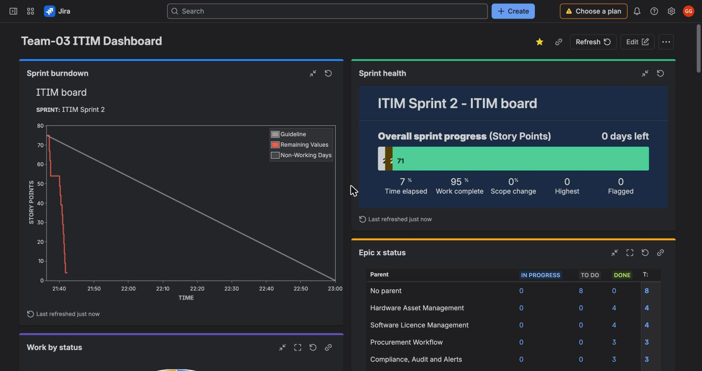
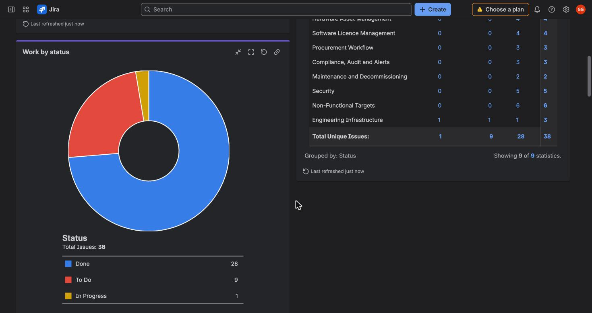
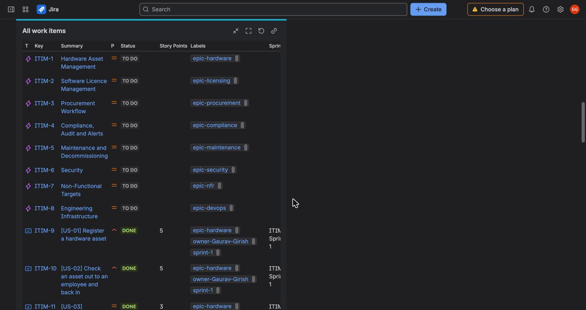

The dashboard combines the live sprint burndown, sprint health, a work-by-status pie chart, an epic × status table and the full list of work items. The list shows each item's status, story points, `owner-<name>` label and sprint. The "No parent" row in the epic table is the 8 epics themselves.

## 2. Product backlog

Both sprints planned in the backlog with story points, epics and priorities, before Sprint 1 was started.

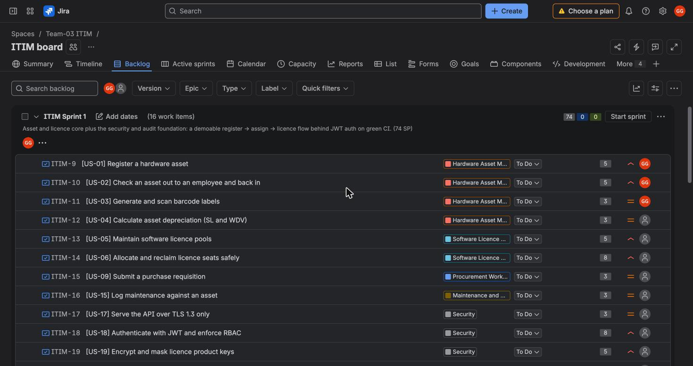
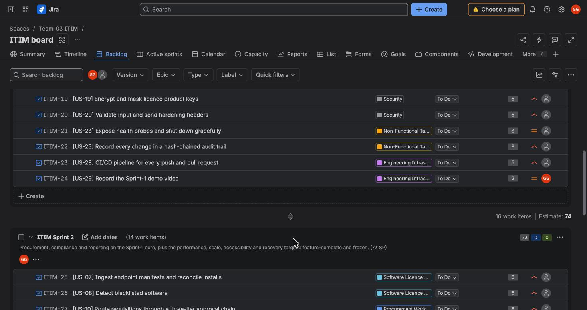
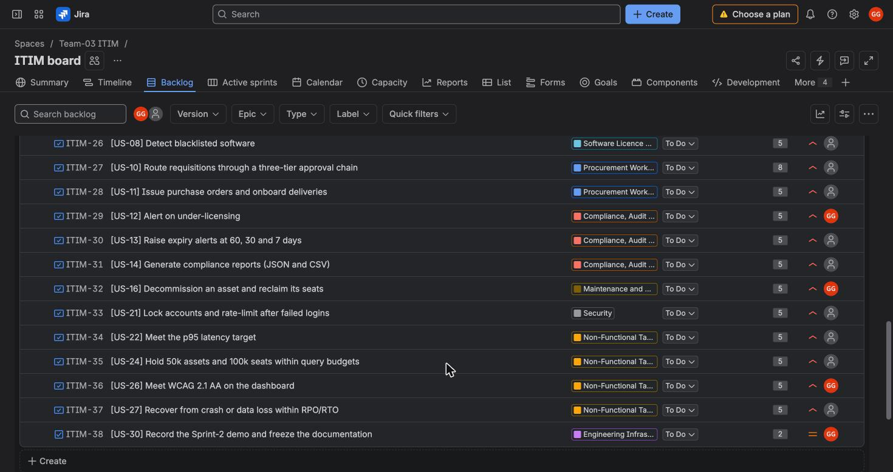
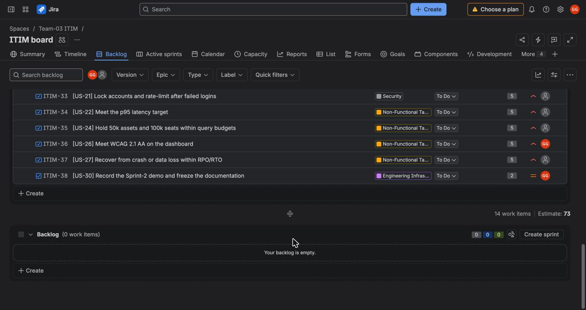

## 3. Sprint backlogs

**Sprint 1** — 16 items, 74 SP. Goal: asset and licence core plus the security and audit foundation, a demoable register → assign → licence flow behind JWT auth on green CI. The Sprint 1 backlog is shown in screenshots 01–02 above.

**Sprint 2** — 14 items, 73 SP, plus US-29 carried over from Sprint 1. Goal: procurement, compliance and reporting on the Sprint-1 core, plus the performance, scale, accessibility and recovery targets.

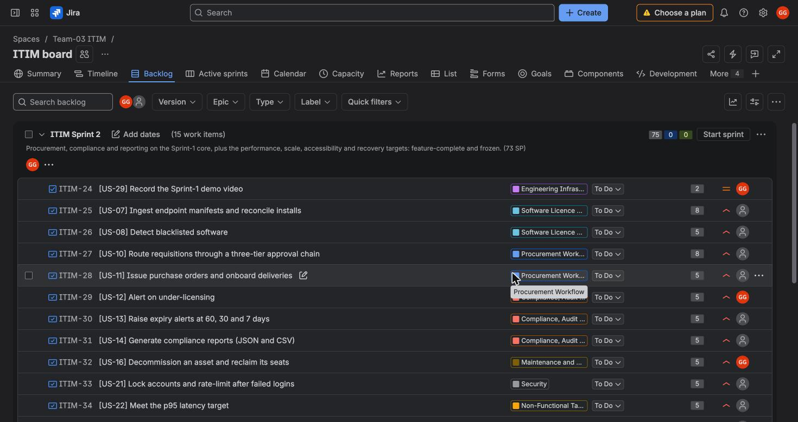

## 4. Sprint progress (board)

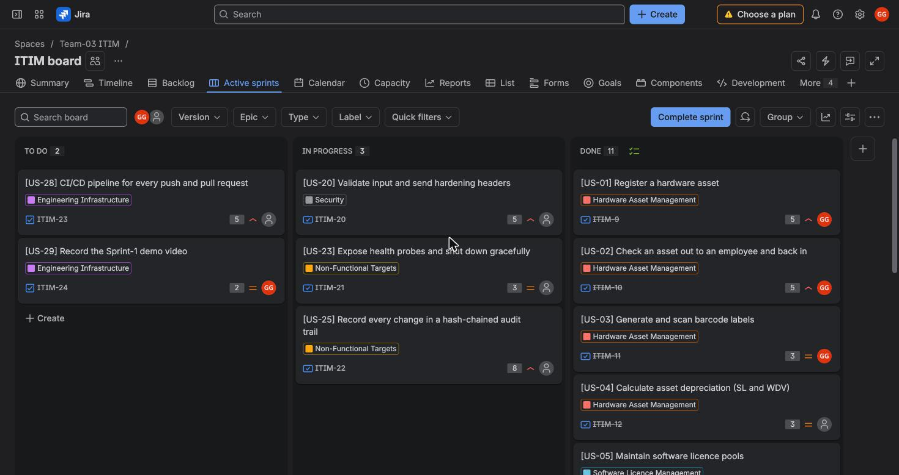
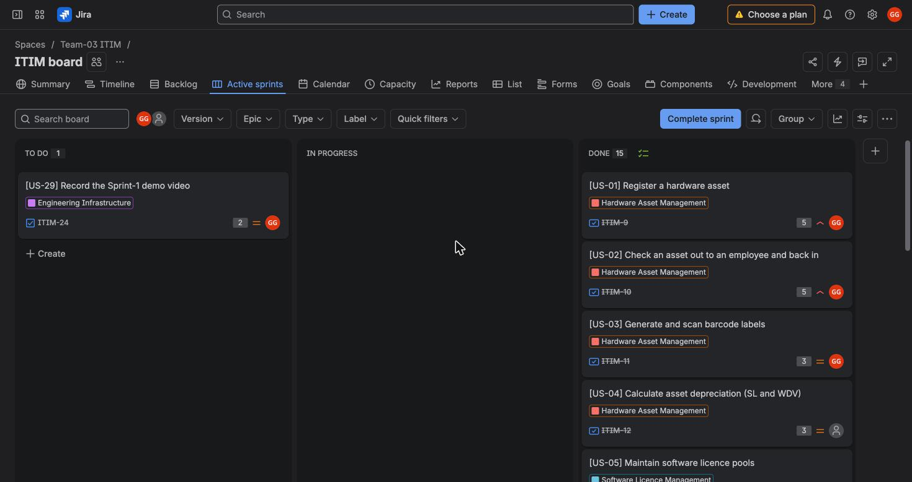
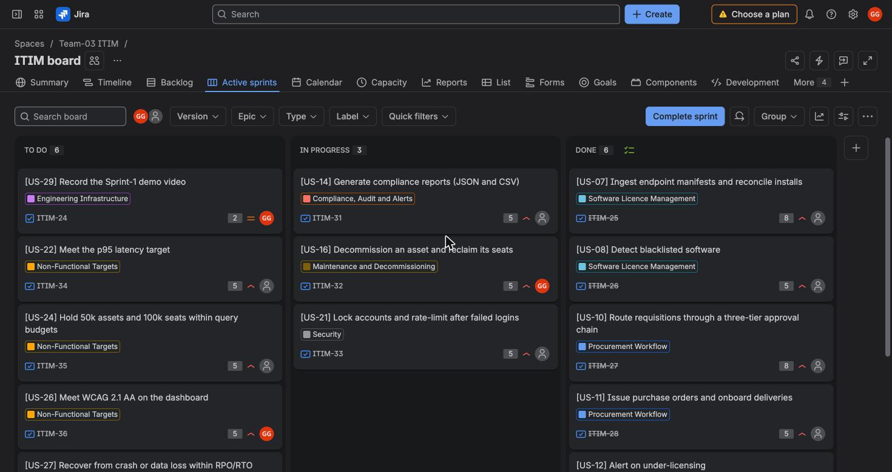

## 5. Burndown charts and sprint reports

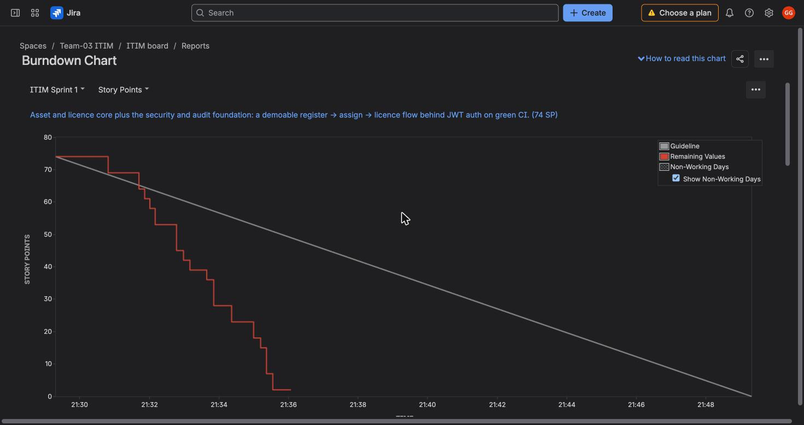
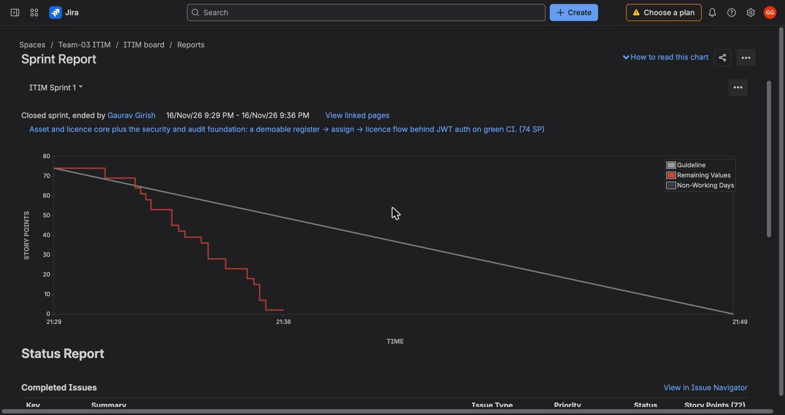
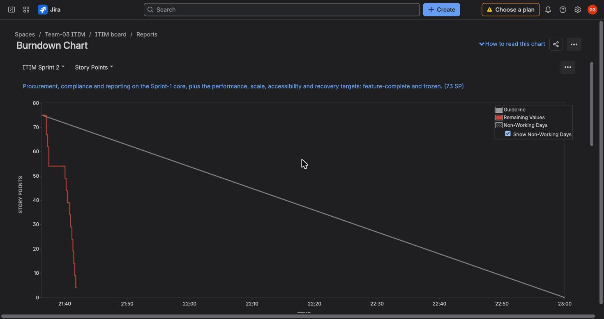
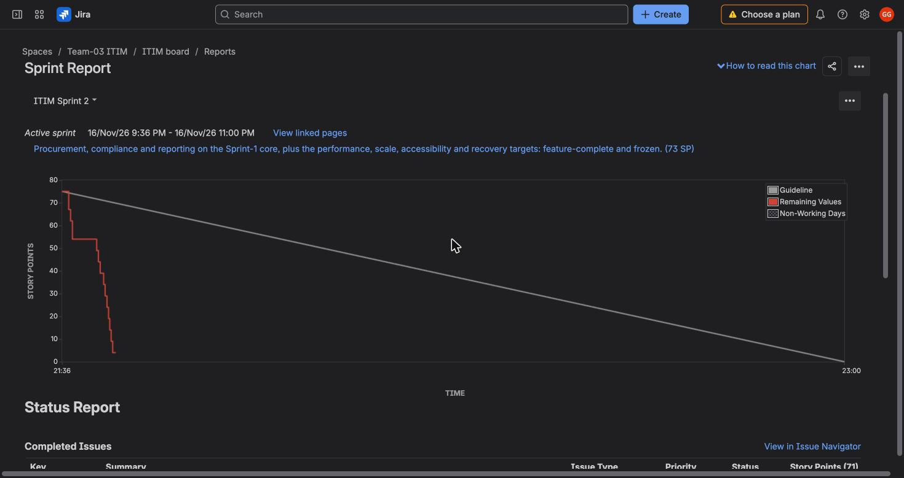

## 6. Deviation from the plan (to explain at the final demo)

- **Jira was set up late.** During development the backlog and sprints were tracked in [GitHub Issues](https://github.com/SE-Project-2026-B-sec/Team-03---IT-infrastructure-management-software/issues), [Milestones](https://github.com/SE-Project-2026-B-sec/Team-03---IT-infrastructure-management-software/milestones) and the [GitHub project board](https://github.com/users/gaurav-2030/projects/1). The Jira project was created on **16 Nov 2026** from the same backlog (`docs/jira-import.csv`). Sprint 1 and Sprint 2 were then run in Jira on that day. Each story was moved to Done after the full automated test suite passed (34/34 tests). That is why the burndown charts show times on 16 Nov rather than the planned sprint weeks. The dates were not backdated.
- **Single Jira account.** Only one team member's Atlassian account is on the Jira site, so the other members' stories show as unassigned. Every story's real owner is recorded in its `owner-<name>` label and in the *Assigned to* row of its description. The same owners are set as assignees on the GitHub issues.
- **Demo videos.** US-29 (Sprint-1 demo video) was not finished in Sprint 1 and was carried into Sprint 2. Both videos were recorded on 16 Nov 2026 from the running product (`npm run demo`) and are in [`docs/demo/`](../demo): [Sprint 1](../demo/sprint1-demo.mp4) and [Sprint 2](../demo/sprint2-demo.mp4). The burndown screenshots above were taken before the recordings, so they still show US-29 and US-30 as open.
